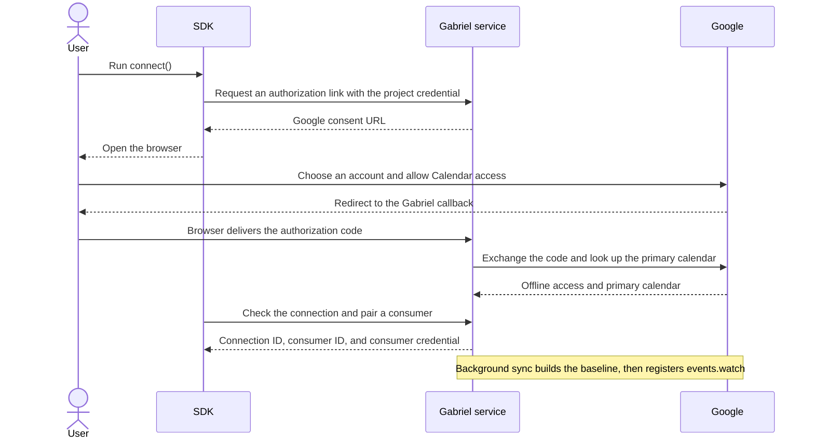
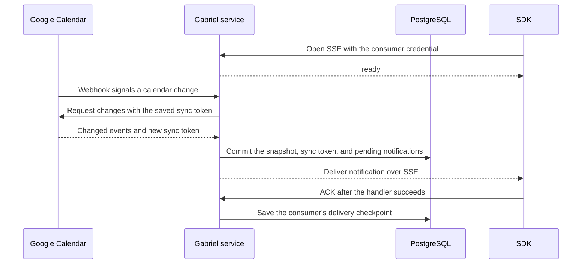

# Gabriel Calendar

**Real-time Google Calendar SDKs for Node.js and Python.**

Listen for meeting invitations, reschedules, cancellations, and RSVP changes on a user's primary calendar. Query pending invitations, reply to them, and create, update, or cancel single events. The Gabriel Calendar service handles Google OAuth and calendar sync. The SDK delivers changes to your app over SSE.

[简体中文](README.zh-CN.md) · [Quick start](#quick-start) · [Client API](#client-api) · [Architecture](#architecture)

## SDKs

| Language | Package | Status |
| --- | --- | --- |
| TypeScript / Node.js | [`gabriel-calendar` on npm](https://www.npmjs.com/package/gabriel-calendar) | Preview (0.1) |
| Python | [`gabriel-calendar` on PyPI](https://pypi.org/project/gabriel-calendar/), import `gabriel_calendar` | Preview (0.1) |

## Quick start

If your team already runs Gabriel Calendar, ask the operator for its HTTPS base URL and your own project session. Set `GABRIEL_BASE_URL` to the service origin, such as `https://calendar.example.invalid`, and inject `GABRIEL_PROJECT_SESSION` from your secret store. `connect()` opens Google consent. Choose the account your operator has approved for the test project.

### Node.js (22+)

```bash
npm install gabriel-calendar
```

Save as `listen.mjs` and run `node listen.mjs`.

```js
import { CalendarClient } from "gabriel-calendar";

const client = await CalendarClient.connect({
  baseUrl: process.env.GABRIEL_BASE_URL,
  getProjectCredential: () => process.env.GABRIEL_PROJECT_SESSION,
});

client.on("invitation.received", (notice) => {
  console.log(notice.type);
});

await client.start();
try {
  console.log("Listening for new invitations. Press Ctrl+C to stop.");
  await new Promise((resolve) => process.once("SIGINT", resolve));
} finally {
  await client.stop();
}
```

### Python (3.11+)

```bash
python -m pip install gabriel-calendar
```

Save as `listen.py` and run `python listen.py`.

```python
import asyncio
import os

from gabriel_calendar import CalendarClient


async def main():
    client = await CalendarClient.connect(
        base_url=os.environ["GABRIEL_BASE_URL"],
        get_project_credential=lambda: os.environ["GABRIEL_PROJECT_SESSION"],
    )

    @client.on("invitation.received")
    def handle_invitation(notice):
        print(notice.type)

    async with client:
        print("Listening for new invitations. Press Ctrl+C to stop.")
        await asyncio.Event().wait()


try:
    asyncio.run(main())
except KeyboardInterrupt:
    pass
```

After the first sync completes, send a new test invitation to the connected account. The listener prints `invitation.received`. To resume after a restart, save the consumer grant with `saveGrant` or `save_grant` and reuse it with the client constructor.

## Client API

- [Node.js SDK guide](sdks/node/README.md#client-api) and [Python SDK guide](sdks/python/README.md#client-api) cover client options, listening, invitation queries, RSVP, and event writes.
- [Shared SDK contract and examples](spec/api.md#sdk-surface) show both languages side by side. See also the [notification schema](spec/schema/notification.schema.json) and [error reference](spec/api.md#events-and-errors).

## Architecture

### First connection

The operator registers the user and issues a personal project credential. The service uses it to identify the user before opening Google consent. [User and permission setup](docs/zh-CN/testing.md#人员与权限管理)



### From a calendar change to your app



Periodic sync covers missed Google callbacks. On reconnect, the same consumer resumes from its saved checkpoint. For a write, the service validates the consumer grant and limits the operation to the linked primary calendar before calling Google.

## Highlights

- **Invitation workflows.** Listen for new invitations, list invitations that need a reply, and set your own RSVP to accepted, tentative, or declined.
- **Durable delivery.** The SDK reconnects and resumes from the last acknowledged notification. It acknowledges a notification after its handlers succeed.
- **Event writes.** Once connected, create single timed events with an idempotency key or update and cancel events you organize using their current version. Pass `notifyGuests` or `notify_guests` explicitly when guests are involved.

## Service and development

One deployment serves one Google test project and can connect the primary calendars of multiple approved users. The operator maintains OAuth, the webhook, and PostgreSQL. [Service setup and deployment](docs/zh-CN/testing.md) · [HTTP API](spec/api.md#http-endpoints) · [Synchronization behavior](spec/behavior.md)

```bash
npm ci
npm test
npm run test:python
```

[Contributing](CONTRIBUTING.md)

## License

Gabriel Calendar is independent of Google and uses the [MIT license](LICENSE).
