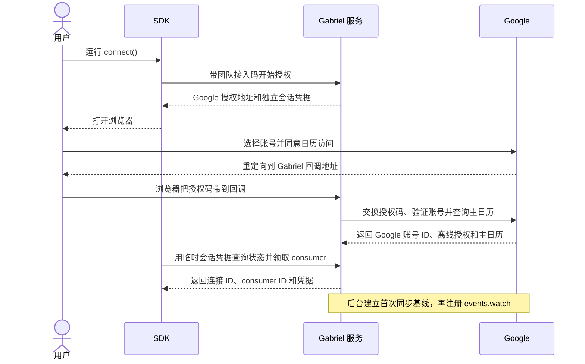
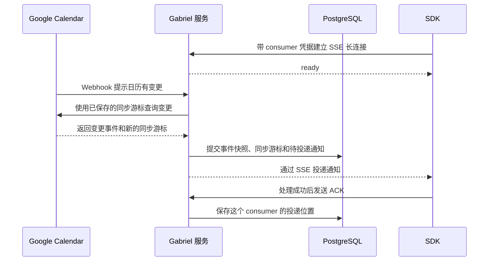

# Gabriel Calendar

**面向 Node.js 和 Python 的 Google Calendar 实时 SDK。**

监听主日历的会议邀请、改期、取消和 RSVP 变化。可以查询待回复邀请、提交自己的回复，也可以创建、更新和取消单次会议。服务端处理 Google OAuth 和日历同步，SDK 通过 SSE 把变更送到你的应用。

[English](README.md) · [快速上手](#快速上手) · [客户端 API](#客户端-api) · [架构与流程](#架构与流程)

## SDK 列表

| 语言 | 包 | 状态 |
| --- | --- | --- |
| TypeScript / Node.js | [npm 上的 `gabriel-calendar`](https://www.npmjs.com/package/gabriel-calendar) | 预览版（0.1） |
| Python | [PyPI 上的 `gabriel-calendar`](https://pypi.org/project/gabriel-calendar/)，导入 `gabriel_calendar` | 预览版（0.1） |

## 快速上手

向管理员拿到 HTTPS 服务地址和团队共享接入码。`GABRIEL_BASE_URL` 填服务域名地址（例如 `https://calendar.example.invalid`），`GABRIEL_ENROLLMENT_TOKEN` 由密钥存储注入。`connect()` 会打开 Google 授权页，授权后 SDK 获得你自己的日历凭据。Google 仍处于 Testing 时，请选择已加入测试名单的账号。

### Node.js（22+）

```bash
npm install gabriel-calendar
```

保存为 `listen.mjs`，运行 `node listen.mjs`。

```js
import { CalendarClient } from "gabriel-calendar";

const client = await CalendarClient.connect({
  baseUrl: process.env.GABRIEL_BASE_URL,
  token: process.env.GABRIEL_ENROLLMENT_TOKEN,
});

client.on("invitation.received", (notice) => {
  console.log(notice.type);
});

await client.start();
try {
  console.log("Listening for new invitations. Press Ctrl+C to stop.");
  await new Promise((resolve) => process.once("SIGINT", resolve));
} finally {
  await client.stop();
}
```

### Python（3.11+）

```bash
python -m pip install gabriel-calendar
```

保存为 `listen.py`，运行 `python listen.py`。

```python
import asyncio
import os

from gabriel_calendar import CalendarClient


async def main():
    client = await CalendarClient.connect(
        base_url=os.environ["GABRIEL_BASE_URL"],
        token=os.environ["GABRIEL_ENROLLMENT_TOKEN"],
    )

    @client.on("invitation.received")
    def handle_invitation(notice):
        print(notice.type)

    async with client:
        print("Listening for new invitations. Press Ctrl+C to stop.")
        await asyncio.Event().wait()


try:
    asyncio.run(main())
except KeyboardInterrupt:
    pass
```

首次同步完成后，给已连接的账号发一封新的测试邀请，终端会打印 `invitation.received`。需要在重启后续接时，用 `saveGrant` 或 `save_grant` 保存 consumer grant，下次通过客户端构造函数复用。

## 客户端 API

- [Node.js SDK 文档](sdks/node/README.md#client-api)和 [Python SDK 文档](sdks/python/README.md#client-api)列出初始化参数、事件订阅、邀请查询、RSVP 和会议写入方法。
- [两种语言的 API 对照与示例](spec/api.md#sdk-surface)汇总方法签名。[通知 Schema](spec/schema/notification.schema.json)和[错误码](spec/api.md#events-and-errors)说明返回的数据和错误。

## 架构与流程

### 首次连接

管理员在 `/admin` 生成团队共享接入码。每次授权都有独立的临时会话凭据，服务根据 Google 验证的账号绑定日历。[接入码与连接管理](docs/zh-CN/testing.md#接入码与连接管理)



### 日历变更如何到达应用



Google 漏发 Webhook 时，定期增量同步会补收。SDK 断线后使用同一个 consumer 从已确认的位置继续接收。写操作由服务验证 consumer 凭据，并限定在已连接的主日历上。

## 主要能力

- **处理邀请。** 监听新邀请、查询待回复邀请，把自己的回复设为接受、暂定或拒绝。
- **断线续接。** SDK 会重新连接，从已确认的位置继续接收通知。处理函数成功后才发送 ACK。
- **写入日历。** 连接后即可通过幂等键创建单次定时会议，或使用事件版本更新、取消自己组织的会议。涉及来宾时明确传入 `notifyGuests` 或 `notify_guests`。

## 服务端与本地开发

一个服务对应一个 Google 测试项目，可以接入多个获准用户的主日历。管理员统一维护 OAuth、Webhook 和 PostgreSQL。[服务端部署](docs/zh-CN/testing.md) · [HTTP 接口](spec/api.md#http-endpoints) · [同步与投递规范](spec/behavior.md)

```bash
npm ci
npm test
npm run test:python
```

[贡献指南](CONTRIBUTING.md) · [MVP 范围](docs/zh-CN/mvp.md)

## 许可证

本项目与 Google 无隶属关系，采用 [MIT 许可证](LICENSE)。
